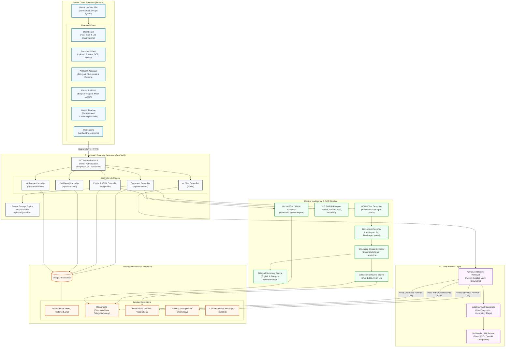

# System Architecture & Technical Design: HealthCopilot Personal Vault

## 1. System Overview
**HealthCopilot Personal Vault** is an AI-powered personal health data platform built with the MERN stack (MongoDB, Express.js, React, Node.js) featuring end-to-end medical document intelligence, OCR, bilingual summaries (English and Telugu), FHIR R4 interoperability, ABDM/ABHA sandbox readiness, and user-isolated zero-trust security.

---

## 2. Comprehensive System Architecture Diagram (Mermaid)

---

## 3. Trust Boundaries & Privacy Architecture

### 3.1 Strict User-Isolated Storage
- Physical file uploads are written strictly to `uploads/{userId}/{filename}`.
- All file retrieval (`GET /api/documents/:id/file`) checks both `_id: documentId` AND `userId: req.user.id`.
- Attempted path traversal (e.g. `../`) is blocked by `path.resolve` and checked against root upload bounds.

### 3.2 AI Grounding & Zero Data Leakage
- The AI Health Assistant retrieves authorized clinical records belonging strictly to `req.user.id`.
- Conversations and dynamic history titles are strictly queried with `{ _id: convId, userId: req.user.id }`.
- Prompt injection and out-of-context fabrication are mitigated by grounding system instructions with cited excerpts.

### 3.3 Clinical Safety Guardrails
1. **Informational Only**: AI responses and summaries explicitly carry mandatory disclaimers and never substitute for licensed doctor consultations.
2. **Preserving Laboratory Reference Ranges**: Numeric values, units (e.g., `mg/dL`, `g/dL`), and original laboratory intervals are never modified or guessed.
3. **Telugu Summary Fidelity**: In Telugu translations, numeric test results and medicine brand names remain identical to eliminate clinical ambiguity.
4. **Mock ABDM Readiness**: Simulated ABHA linking clearly displays a sandbox badge and sample records are explicitly labeled with `provenance: ABDM_SANDBOX`.
